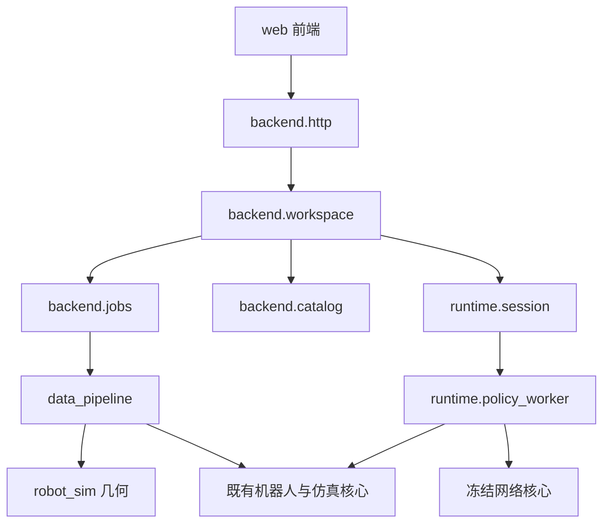

# 源码模块边界与第一轮迁移

2026-11-04用户批准按七个职责模块开始修改源码。第一轮已实际迁移数据流水线、共享几何查询、后端服务和推理会话；前端继续使用原web目录，训练/评估的冻结算法核心保留原路径。旧兼容入口已按用户要求删除，使用新模块路径，不创建空的learning/evaluation包来冒充迁移完成。

## 当前源码布局

```text
dax_supermimic/
  common/                 项目资源根路径、JSON证据与哈希I/O
  data_pipeline/
    pipeline.py           配置、配方、阶段状态机和独立发布
    generation.py         平滑扰动与几何阶段编排
    processing.py         时序、速度重采样、CSV/full20写出
    quality.py            离散路径筛查、pair策略与诊断分类
    workers.py            显式初始化的进程内几何上下文
    physics.py            完整直接PD物理回放
    validation.py         变速参考/实际状态验证及阶段编排
    records.py            物理记录完整性绑定
    evidence.py           逐候选gate凭据
    training_release.py   从通过名单与既有基线组装新训练发布
    teleop.py             遥操requested_q参考发布
    legacy.py             历史递归检查，供历史对照
  robot_sim/
    collision.py          编译凸几何距离、显式排除与旧路径查询
    elbow.py              肘下指标、锚点与旧区间查询
  backend/
    http.py               8770路由、同源JSON限制、服务生命周期
    reference_preview.py  参考缓存、网格/场景与静态资源服务
    workspace.py          几何编辑和工作台服务组合
    jobs.py               固定入口的后台生成任务管理
    catalog.py            已发布参考与物理记录预览
  runtime/
    session.py            策略会话、子进程/pipe及session控制
    policy_worker.py      隔离的冻结Actor仿真worker
    bridge.py             手头目标映射和冻结Actor推理
  web/                    原前端HTML/CSS/JS，不移动页面入口
  train.py/evaluate.py/   冻结学习与评估核心继续保留原位置（实际实现）
  networks.py/buffer.py/
  env.py/mdp.py/...       既有机器人/仿真及算法核心适配

```

## 七个职责模块的实际状态

| 模块 | 本轮结果 | 边界 |
| --- | --- | --- |
| 数据生成与处理 | 已迁入data_pipeline | 生成/处理/筛查/记录/发布拆分，明确分别负责数据还是物理状态 |
| 机器人与仿真 | 共享几何已迁入robot_sim，其余核心留原路径 | 生产模块不再通过sys.path引用scripts里的实验类 |
| 训练框架 | 保留冻结核心和原CLI | 网络/Replay/WM/Actor/critic/优化器/分布式与数值默认不变 |
| 评估验证 | 保留冻结evaluate入口 | 不借本轮重构改奖励、评价指标或数据划分 |
| 推理与桥接 | 已迁入runtime | 会话、隔离worker与目标桥接独立于HTTP，不含新增硬件发送 |
| 后端服务 | 已迁入backend | 路由不持有生成算法，任务控制/资料库/会话分别委派 |
| 前端 | 保留web模块及原8770集成 | HTTP路径、页面字节及输入参数契约保持 |

common只包含稳定资源定位和证据I/O，不承载业务逻辑。当前training_data.py的几何安装适配及robot/env/mdp仍在既有根模块，供这些业务模块复用；不把七个职责模块都宣称为已完成目录迁移。



数据流水线、几何基础层不依赖HTTP、后端或web；robot_sim不反向依赖data_pipeline。维护测试检查这两条依赖边界。数据流水线仍可调用原TrackingSim完成完整回放，训练/评估复用同一机器人与动作契约。

## 当前入口与版本规则

当前只使用新模块入口：

```bash
bash scripts/dax_supermimic_python.sh -m dax_supermimic.data_pipeline.teleop --help
bash scripts/workbench_dax_supermimic.sh --port 8770
bash scripts/dax_supermimic_python.sh scripts/run_dax_augmentation.py --help
```

原generation_pipeline/generation_augment/generation_geometry/workbench/data/workspace_sim/rollout_bridge/preview根模块及旧preview启动脚本已删除，不保留导入别名或私有worker上下文转发。工作台启动脚本执行backend.http；数据处理使用data_pipeline。稀疏目标桥接v0已退役。8766～8769跳转监听也已撤掉，工作台仅8770。历史报告/源码快照中的旧路径只保留历史意义。

新计划的implementation_sha256绑定实际data_pipeline/robot_sim/common实现，不再校验已删除的shim。workflow_sha256对应新的pipeline实现；旧未完成计划不能跨版本继续，应新建计划。旧已发布任务仍可读，历史文件/凭据/模型/训练包不迁移、不重签。

## 正式训练数据组装接口

新增[build_training_release](../../dax_supermimic/data_pipeline/training_release.py)，替代未来依赖verification目录专用组装脚本的做法：输入基线发布、全部通过的增强名单和新输出目录；继承train/val划分，加入全部合格增强，不设来源配比。检查CSV/full20、物理记录绑定与凭据hash，原目录及已有staging拒绝覆盖，成功后原子发布。

```bash
bash scripts/dax_supermimic_python.sh scripts/prepare_dax_training_release.py \
  --index verification/dax_custom_generation_3600_20261104/training_candidates.json \
  --baseline data/dax_mixed_teleop_synthetic_v3_20261103 \
  --output data/一个尚不存在的新发布目录
```

该命令会复制并发布数据，不在本轮对真实4920训练片段重复执行；仅以临时夹具验证组装。原3981增强名单和4920训练包保持原样，未增加清洗结果、未消除历史900/39来源的筛查缺口，也未启动训练。

## 验收范围

见[重构验收](../../verification/dax_modularization_20261104/report.md)：78项相关测试、冻结上游一致性校验、46个迁移符号AST对照、14个核心文件及3个数据清单hash未变；一条已有参考在隔离验证目录完成2001步直接PD回放与发布，CSV逐字节一致；原8770重载后HTTP/历史发布读取/前端文件一致性及冻结Actor两步IPC物理会话通过并关闭。

单条回放和两步会话是结构重构验收，不是全量训练加载、策略精度复验或硬件验收。首次真实集成发现的迁移字段拼写问题已修复，失败job/log保留；最终集成和AST对照均通过。


## 旧兼容层删除验收（2026-11-04）

用户明确授权不兼容旧入口后，已更新当前scripts/tests/config和启动说明，并移除8个根模块入口和1个旧预览shell脚本。ReferencePreview实际实现迁至backend/reference_preview.py；main仅监听8770。历史源码/证据不重写，原训练/评估入口与数据保持。见[清理报告](../../verification/dax_remove_legacy_entries_20261104/report.md)。
